# Journal de développement SmartPortal

Le projet Smart-Portal-BLE est une sous branche du projet Smart-Portal visant à automatiser l'autorisation d'accès à mon portail électrique via un système d'identification Bluetooth Low Energie.

**Quel objectif ?** Détecter la présence d'une personne ou d'un véhicule, identifier le badge BLE puis ouvrir le portail ou portillon.

**Intégration**: Le système s'interface avec le système existant d'ouverture/fermeture du portail avec télécommande. Le nouveau système n'empêche pas le fonctionnement actuel mais ajoute une identification sans fil.

**Pourquoi Bluetooth Low Energie ?** Pour identifier une personne/un objet il existe plusieurs méthodes : soit **passive** (ex: détection par caméra) soit **active** (ex: détection par badge). Généralement un système passif demandera un coût et une technologie supérieur "coté portail" (ex: Reconnaissance visuel) mais **sans contrainte pour l'utilisateur**. Au contraire, un système actif sous entend que l'utilisateur possède la "clé" de l'identification, cela simplifie grandement le système et réduit le coût mais **impose à l'utilisateur d'avoir un équipement** consommateur d'énergie sur lui. C'est ce dernier choix qui est fait ici, le **BLE (Bluetooth Low Energie)** permet d'émettre périodiquement un identifiant basse consommation permettant d'identifier un objet ou une personne.

# Equipements

## Arduino Nano ESP32

Tout est piloté par une **Arduino Nano ESP32** acheté **25€ sur Amazon**:

Elle intègre le WIFI et le BLE, basse consommation et abordable.

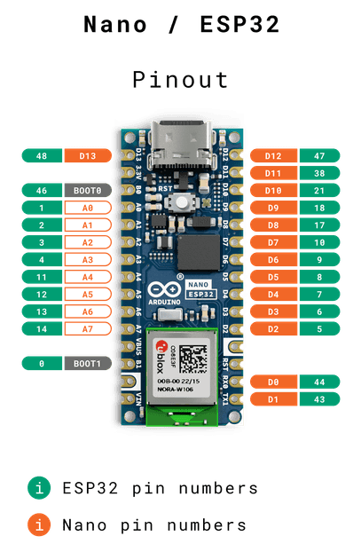

## Détecteur de présence

**8€ les 3 détecteurs** et **2 boitiers extérieurs pour 16€** sur Amazon.

Pas très fiable mais abordable il feront l'affaire dans un premier temps.

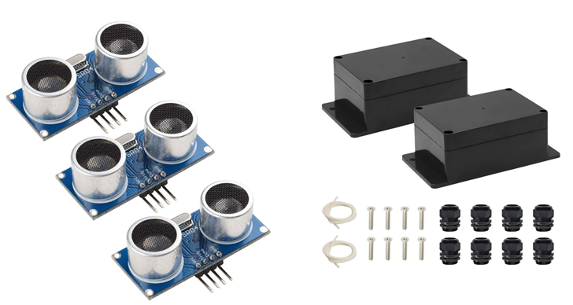

## Détecteur de porte

Acheté **14€ sur Amazon** il va donner l'information si le portail est ouvert ou fermé.

Son fonctionnement est très simple avec 2 fils il fonctionne comme un contact à aimant.


## Badge BLE

Nous pouvons différencier plusieurs types de badges BLE:

* **Beacon BLE** : C’est la technologie la plus basique, le tag diffuse simplement un identifiant unique via publicité BLE (“advertising packets”).
* **Find My** : Les tags modernes utilisent un immense réseau d’appareils tiers. Le tag BLE émet un identifiant chiffré

Ici ce sont plutôt les **Beacon BLE** qui nous intéressent (iBeacon, Eddystone, AltBeacon).

J'ai acheté 3 badges pour réaliser mes tests:

* **Galaxy SmartTag2** (x1) pour **29€**
* **VOCOlinc Smart Air Tag** (x2) pour **19€**
* **echo Smart Tag** (x1) pour **17€**

# Grafcet Principal

Le système imaginé est le suivant:

* L'utilisateur possède un badge BLE émettant une clé spécifique
* Le système possède 2 détecteurs de présences: 1 orienté vers le portillon et l'autre vers le portail
* Le système possède une puce BLE permettant de scanner l'environnement à la recherche de badge
* Lorsque le système détecte la présence d'une personne ou d'un véhicule et d'un code badge connu la demande d'ouverture est transmise au système de portail

Le Grafcet suivant représente le fonctionnement du PRINCIPAL :

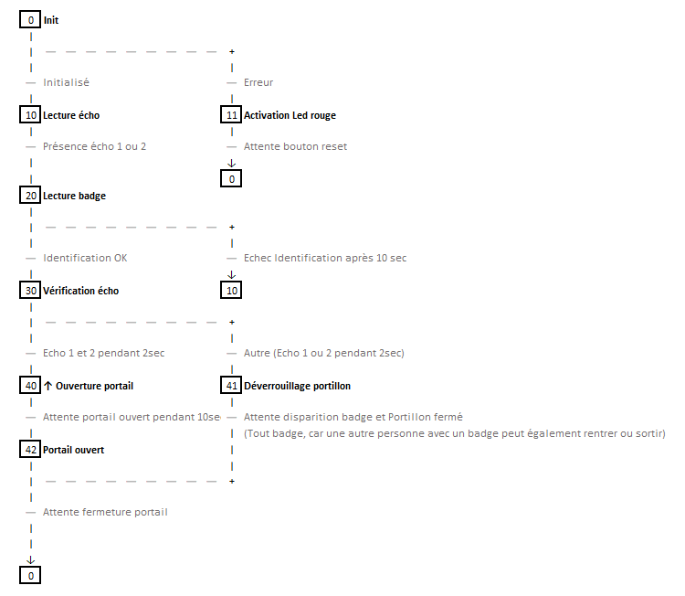

# Grafcet Reset

Le système n'étant pas à l'abri d'un bug de fonctionnement j'estime qu'il doit être réinitialisé si ce dernier reste bloqué trop longtemps dans les étapes de détection.

Le Grafcet suivant représente le fonctionnement du RESET :

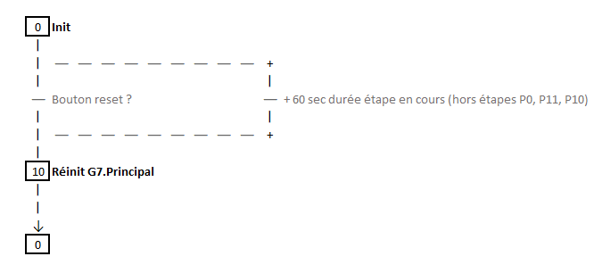

# Développement initial

Pour réaliser une implémentation du grafcet semblable à ce que ferait un automate industriel, je structure mon code ainsi (version simplifié):

```c++
struct SEQ G7_Reset;
struct SEQ G7_Principal;
struct SEQ G7_Commandes;

void Inputs();
void Outputs();
void Commandes();

void setup()
{
  // initialisation des variables globales et librairies WIFI ...
  // initialisation des structures de sequences et timers ...
  // initialisation console ...
  // initialisation PINS ...
}

void loop()
{
  // Lit les entrées et place dans des variables globales
  Inputs();

  // Execute les sequences
  SEQ_Run(&G7_Principal);
  SEQ_Run(&G7_Reset);
  SEQ_Run(&G7_Commandes);

  // Calcule les variables de sorties (en fonction des etapes de sequences)
  Outputs();

  // Ecrit les sorties dans les PINS
  Commandes();

  // Attend la fin du cycle (bouclage du programme sur une période fixé)
  waitCycle();
}
```

De cette façon, il devient beaucoup plus simple de développer les séquences et déboguer les états.

La totalité du code est à retrouver dans le dossier [arduino](arduino). 

# Test des badges BLE (le problème)

Quelques remarques avec les badges leurs utilisations.

**La librairie BLEDevice**

Extrait du code utilisé pour récupérer l'identifiant public du badge:

```c++
for(int i=0; i < results.getCount(); i++)
{
    BLEAdvertisedDevice device = results.getDevice(i);

    // On récupère le RSSI (puissance du signal ~= distance avec le badge)
    int rssi = device.getRSSI();

    // On récupère le Service UUID
    if (device.haveServiceUUID())
    {
        BLEUUID devUUID = device.getServiceUUID();

        // ce code est il connu ?
        if (devUUID.equals(TagsUUID[j]))
        {
          // OK
        }
    }
}
```

**Galaxy SmartTag2**

* Fonctionne plutôt bien, il émet un identifiant régulièrement.

**VOCOlinc Smart Air Tag**

* Fonctionne bien, il émet un identifiant régulièrement MAIS dispose d'un système de veille automatique conçu pour économiser la batterie. Le dispositif reprend vie après un court appuie sur le bouton. ASSEZ GENANT AVEC L'UTILISATION ATTENDU

**echo Smart Tag**

* Compatible "Apple Find My" est totalement inutilisable car il n'émet pas de code public. Il reste confiné à l'écho-système Apple ! NEXT

# Installation initiale

## Boite de raccordement

Le système bien que simple nécessite plusieurs câbles et dérivations pour rester maintenable.

Ici le boitier extérieur avec son bornier dans lesquels les câbles des éléments extérieurs convergents (détecteur de présence, alimentation, commande portail, détecteur de porte, ...)

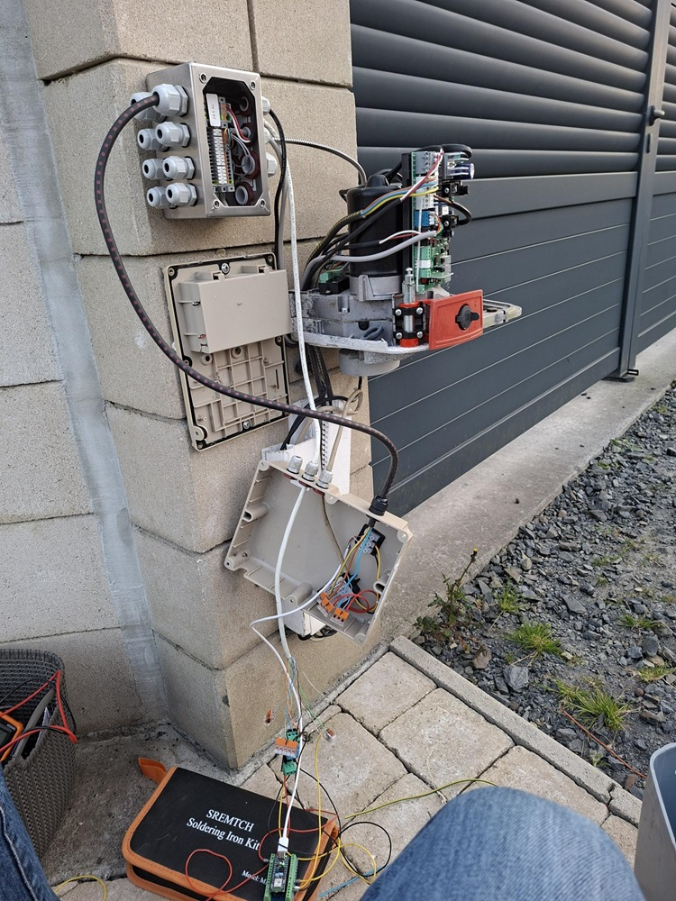

## Raccordement au portail

Le portail possède une carte électronique au niveau du moteur gauche

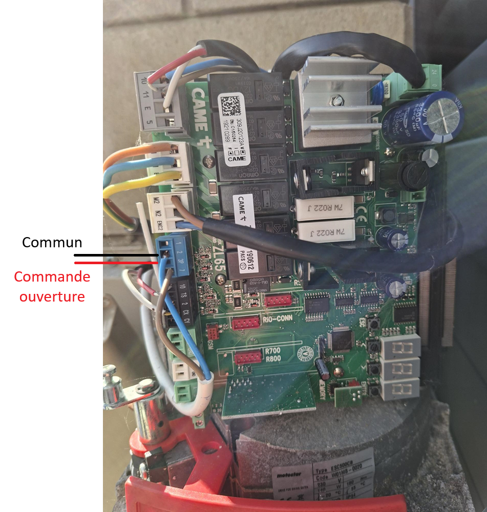

Et le schéma de raccordement...

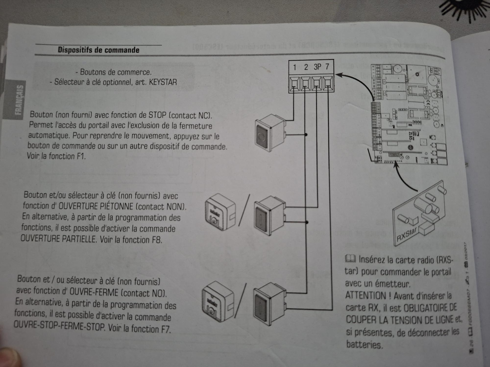

## Schéma électrique

Voici le schéma électrique mis au propre:

Remarquez que nous travaillons avec 3 tensions différentes :

* 3.3v DC (Arduino)
* 5v DC (modules HC)
* 24v AC (circuit Portail)

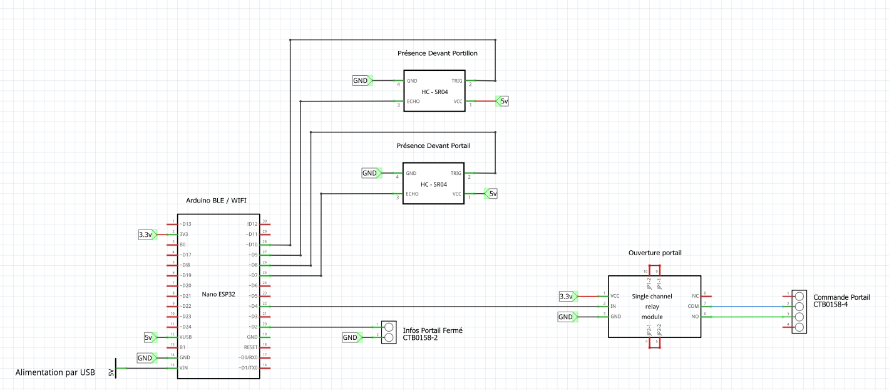

# Ajout des Commandes distantes

Maintenant en place, le débogage et le suivi des états de l'Arduino devient plus difficile. Pour résoudre ce problème l'ajout d'une interface réseau pour envoyer des commandes et recevoir les états du graphe à distance devient indispensable.

J'ai choisi l'intégration du protocole MQTT car léger et facile à implémenté mais nécessitant tout de même un serveur (broker) pour fonctionner.

Je dois donc ajouter plusieurs composants à mon système :

* Un serveur pouvant fonctionner H24-7/7
* Un broker MQTT

* Un nouveau graphe "COMMANDES"
* Modifier le graphe "RESET"

## Serveur VM

Pour le serveur j'ai fais le choix d'un PC Fan-less basse consommation mais suffisamment puissant pour faire tourner un hyperviseur de VM/Container (je prévois au passage d'hébergé un serveur domotique tel que **Home-Assistant**)

J'ai choisi ce PC compact pour ~**250€** sur **AliExpress**:

> MLLSE G1 Pro Mini PC, AMD Ryzen 7 5700U processor, 16GB RAM, 512GB SSD

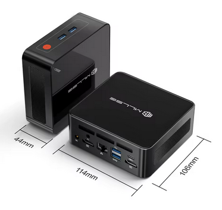

**La stack d'installation est la suivante:**

* OS : ProxMox (Hyperviseur)
  * VM :  Home-Assistant (HAOS)
  * Conteneur LCX : Docker n8n (workflow) + EMQX (Broker MQTT)

Alors tout d'abord exit Windows qui est remplacé par le système **Proxmox**, bien plus léger et permettant d'héberger machines virtuelles et conteneurs Linux.

Ensuite nous avons la **machine virtuelle Home-Assistant** pour avoir une interface graphique pour la domotique maison mais également de réaliser des appels vers **MQTT** et les **WebHooks n8n**.

Enfin le **conteneur LCX** ultra léger pour faire tourner dans un environnement **Docker n8n et EMQX**. n8n permet de créer des automatisations avec l'ensemble des équipements de la maison et MQTT sert uniquement de serveur pour faire transiter les topics MQTT.

Proxmox possède également des fonctions de **redémarrage automatique des VM et conteneurs en cas de crash**. 

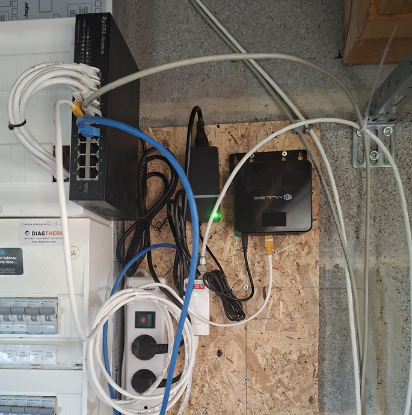

## Grafcet COMMANDES

Souscrit au topic et attend les commandes distantes. Les états sont envoyé à chaque modification de valeur de séquence ou données.

Le Grafcet suivant représente le fonctionnement des COMMANDES :

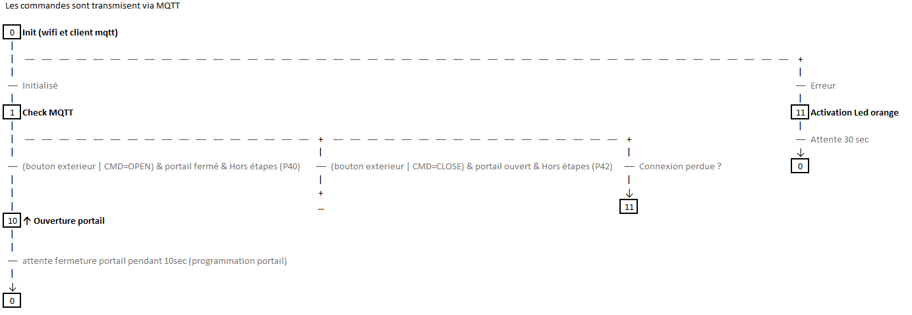

## Grafcet RESET

Tout comme le graphe principal, le graphe de commande n'est pas à l'abri d'un blocage. J'ajoute ce dernier au graphe RESET.

Le Grafcet suivant représente le fonctionnement du RESET :

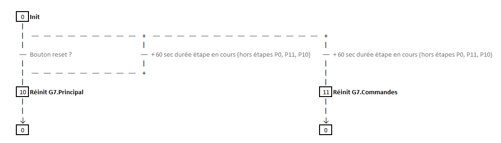

# Le problème du signal BLE dans l'environnement

Dans mon cas l'Arduino (le récepteur BLE) est situé coté intérieur (derrière le mur en béton armé).

Problème: le signal est fortement affaiblie coté rue par rapport au coté court.

En effet, l'antenne se situe directement sur la puce de l'Arduino. Lorsque l'on souhaite estimé la distance avec le badge je dois artificiellement accepter un signal faible pour le détecter hors un signal faible permet de détecter un badge se trouvant dans la maison par exemple. Ce qui pose problème car le portail pourrait s'ouvrir pour n'importe qui !

Solution: je pense qu'il faudrait ajouter une antenne externe placé sur le mur, le signal serait ainsi identique des 2 cotés de celui-ci.

# Intégration de la serrure électrique (la gâche électrique)

Voici le modèle que j'ai commandé **OR-EZ-4029** pour **~30€**.

Il fonctionne en 10/12/24v AC ou DC et permet de récupérer l'info d'ouverture de la porte (il garanti également un fonctionnement en alimentation continue).

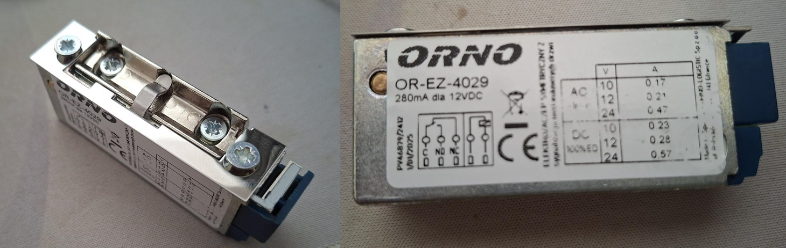

La gâche électrique doit venir s'intégrer à l'emplacement du dormant existant (qu'il faudra modifier).

Ici une première découpe pour tester la mise en place dans le poteau (mais dans mon cas il faudra fabriquer un petit boitier sur-mesure pour le maintenir en place)

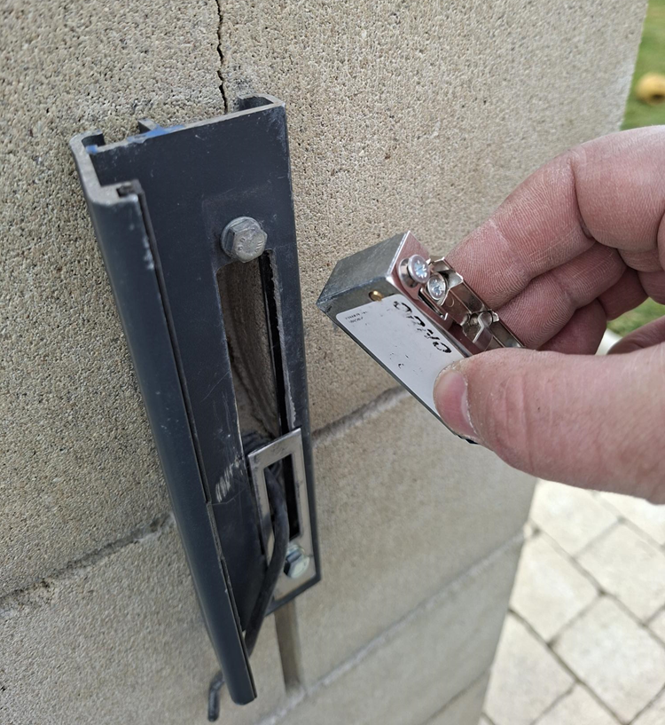 

## Schéma mise à jour

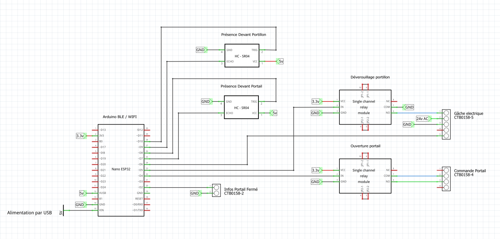